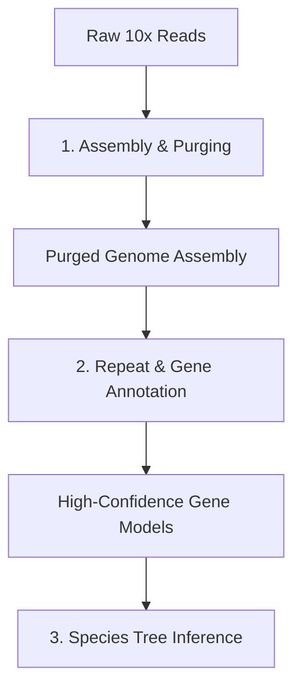

# GAIN4CROP: Genome Assembly, Annotation, and Phylogenomics Pipeline

Welcome to the **GAIN4CROP** repository. This project hosts a comprehensive, end-to-end computational pipeline designed for *de novo* genome assembly, structural and functional gene annotation, expression quantification, and evolutionary species tree inference. 

The pipeline is optimized for high-performance computing (HPC) environments running the **SLURM** workload manager.

---

## 🗺️ Project Architecture Overview

The repository is structured around three major, sequential analytical workflows:



1. **Genome Assembly & Purging:** Reconstructing the genome using linked reads and resolving heterozygosity/haplotigs.
2. **Genome Annotation & Expression:** Characterizing repeat spaces, predicting protein-coding genes, performing functional annotation, filtering out transposable elements, and profiling expression across multiple organs.
3. **Phylogenomics & Species Tree Inference:** Gathering orthologous groups (HOGs) and reconstructing phylogenetic trees using both coalescent (Multi-Species Coalescent) and concatenation (Supermatrix) paradigms.

---

## 📂 Repository Components

Each step in the pipeline is documented with its own clean, dedicated `README.md` and containing scripts. Below is the directory mapping of the project:

### 1. Genome Assembly & Purging (`/assembly`)
* **Purpose:** Builds the raw pseudohaploid assembly and purges heterozygous duplications.
* **Key Tools:** Supernova (10x Genomics), Purge Haplotigs, Minimap2.
* **Execution order:** 1. `script1.sh` (Supernova assembly)
  2. `script2.sh` (Purge Haplotigs curated primary assembly creation)
  3. `busco.sh` (Initial assembly completeness assessment)
* **Documentation:** See [assembly/README.md](./assembly/README.md) *(or adjust relative path as needed)*.

### 2. Repeat & Gene Annotation (`/annotation`)
* **Purpose:** Identifies repetitive elements, models protein-coding genes, runs functional profiling, filters TE contaminants, and estimates tissue-specific expression.
* **Key Tools:** EDTA, Helixer, InterProScan, STAR/Salmon (or similar RNA-seq quantification tools), BUSCO.
* **Execution order:**
  1. `edta.sh` (Repeat masking library construction)
  2. `helixer.sh` (Deep learning *de novo* gene structure prediction)
  3. `interproscan.sh` (Functional domain annotation)
  4. `filter_te_genes.sh` (Filtering annotation with a curated list of TE Pfam domains)
  5. `quantify_expression.sh` (RNA-Seq expression profiling across single/multiple organs)
  6. `busco.sh` (Completeness assessment of the filtered protein dataset)
* **Documentation:** See [annotation/README.md](./annotation/README.md).

### 3. Species Tree Inference (`/phylogenomics`)
* **Purpose:** Compares the predicted proteome against relative species to resolve high-resolution evolutionary relationships.
* **Key Tools:** OrthoFinder, MAFFT, PAL2NAL, RAxML, PartitionFinder, ASTRAL-pro3.
* **Execution order:**
  1. `01_orthofinder.sh` (HOG identification)
  2. `02_classify_hogs.sh` (Classification of single/multi-copy groups)
  3. `03_extract_seqs.sh` (Sequence extraction with Python `SeqIO`)
  4. `04_mafft_align.sh` (Protein sequence MSA)
  5. `05_pal2nal.sh` (Codon-aware nucleotide conversion)
  6. `06_raxml.sh` (Individual gene tree construction)
  7. **Species Tree Option A:** `07a_astral.sh` (Multi-species coalescent with ASTRAL-pro3)
  8. **Species Tree Option B:** `07b_supermatrix.sh` (Single-copy HOG concatenation, partitioning with PartitionFinder, and supermatrix ML tree with RAxML)
* **Documentation:** See [phylogenomics/README.md](./phylogenomics/README.md).

---

## ⚙️ Quick Start

To begin running any portion of the pipeline:

1. **Clone the repository:**
   ```bash
   git clone [https://github.com/your-username/gain4crop.git](https://github.com/your-username/gain4crop.git)
   cd gain4crop
   ```
2. **Configure HPC Allocations:**
   Each shell script is pre-configured with SLURM batch headers. Before submission (`sbatch`), you must open the script and update:
   * `#SBATCH -A [your_allocation_account]`
   * `#SBATCH --mail-user [your_email@domain.com]`
   * Local file paths, project directories, and tool executable pathways.

3. **Step-by-step Guides:**
   Refer to the individual README files inside the `/assembly`, `/annotation`, and `/phylogenomics` directories for detailed instructions regarding input/output expectations, specific dependencies, and parameter configurations.
